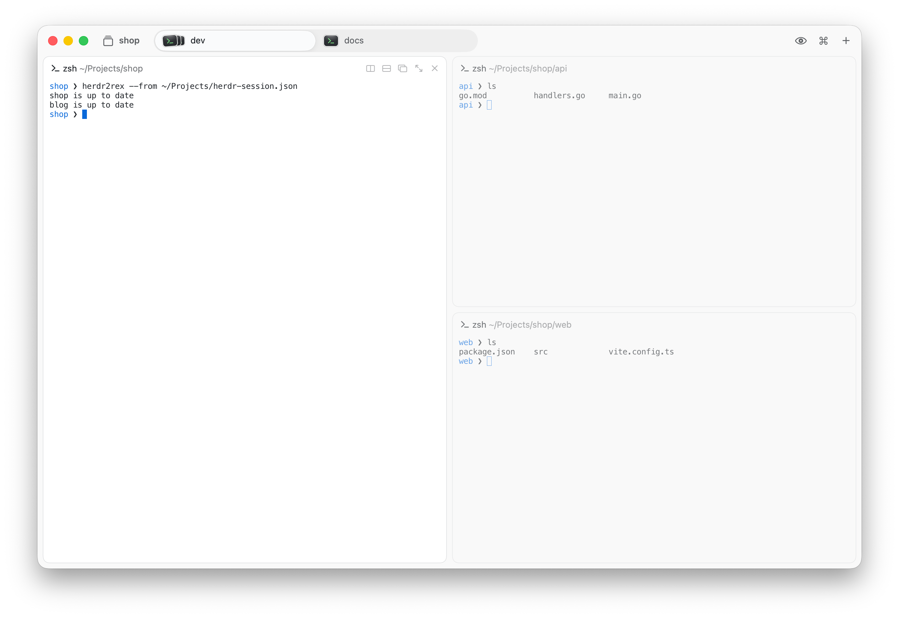

<h1 align="center">herdr2rex</h1>

<h3 align="center">Move your workspaces between herdr and Rex.</h3>

<p align="center">
  
</p>

herdr2rex reads the workspaces you saved in [herdr](https://herdr.dev) and builds them again in [Rex](https://rex.superlogical.com). Every tab, split and folder comes across, and the agent conversations in your panes start again where you left them. With `--reverse`, it takes your Rex sessions back to herdr.

| herdr     | Rex     |
| --------- | ------- |
| workspace | session |
| tab       | window  |
| pane      | block   |

Split directions and sizes stay the same. Workspace and tab names become session and window names. A workspace with no name uses its folder name.

## Your agents come back

A pane that held an agent conversation opens it again in Rex. herdr2rex uses the same command herdr uses when it restores a pane, for example `claude --resume <id>` or `codex resume <id>`. It knows every agent herdr can restore: Claude Code, Codex, Copilot, Devin, Droid, Kimi, Mastra Code, pi, omp, Hermes, OpenCode, Qoder, Qwen, Kilo, Cursor, Antigravity and Grok. Panes with other agents open as a plain shell.

The command is typed into an interactive shell, so functions and aliases from your `.zshrc` work.

herdr saves a conversation only for agents that have its integration installed. If a pane opens without its conversation, install the integration and start the agent again in herdr:

```sh
herdr integration install codex
```

Close a workspace in herdr before you import it. Otherwise the same conversation runs in two places.

## Blocks keep their names

While herdr is running, each agent block gets the title herdr shows for its pane, usually the name of the conversation. If herdr is not running, blocks keep Rex's default name.

## Run it again

herdr2rex remembers which pane became which block. Run it again after you change herdr, and it adds the panes and tabs that Rex does not have yet. A block you closed in Rex comes back too. herdr2rex never closes a block.

A new pane goes next to its nearest neighbour from herdr, so a deep layout can differ a little from the one in herdr. If Rex already has a session with the same name that herdr2rex did not make, the workspace is skipped.

## Go back to herdr

`--reverse` copies your Rex sessions into herdr. herdr must be stopped, because a running herdr writes over its session file.

```sh
herdr server stop       # stops herdr and every process in its panes
herdr2rex --reverse     # every Rex session, or name some: herdr2rex --reverse api blog
rex kill api blog       # close them in Rex, so each agent runs in one place
herdr                   # herdr restores the layout and resumes the agents
```

Each Rex session becomes a herdr workspace with the same windows, splits and folders. It replaces the herdr workspace it came from, or the one with the same name, and leaves the others alone. The old file is kept as `session.json.bak`.

Claude Code conversations come back too. herdr2rex finds the conversation that runs in each Rex block, including ones you started in Rex, and saves it where herdr resumes it. Other agents open as a plain shell.

A workspace that went to Rex and back keeps its pane numbers, so a later import sees it as up to date.

## Install

```sh
git clone https://github.com/tornikegomareli/herdr2rex.git ~/Development/herdr2rex
ln -s ~/Development/herdr2rex/herdr2rex ~/.local/bin/herdr2rex
```

Requirements:

- macOS with Rex. Tested with Rex Beta 0.1.0 (1642).
- herdr. Tested with herdr 0.9.0.
- Python 3.9 or newer. herdr2rex uses only the standard library.

herdr2rex uses the `rex` command on your `PATH`. If there is none, it uses the copy inside Rex's server bundle.

## Using it

```sh
herdr2rex --dry-run    # print the rex commands, change nothing
herdr2rex api blog     # import only these workspaces
herdr2rex              # import every workspace
```

```
$ herdr2rex
imported api
imported blog
$ herdr2rex
added 1 pane to api
blog is up to date
```

`--herdr-file PATH` uses another herdr `session.json`.

## How it works

herdr saves its layout to `~/.config/herdr/session.json`. herdr2rex reads that file and builds the same layout with Rex's own CLI: `rex new`, `rex window new`, `rex split`, `rex block rename` and `rex send`. It never writes Rex's database. Rex keeps its sessions in a SQLite file that the Rex server rewrites while it runs.

`--reverse` goes the other way. It reads each session with `rex session inspect` and asks each block which program runs in it. Claude Code records the conversation of every running process in `~/.claude/sessions/<pid>.json`. herdr2rex writes the result in herdr's own `session.json` format, so herdr restores it the same way it restores its own layout.

The map from herdr panes to Rex blocks is in `~/.local/state/herdr2rex/state.json`, or under `$XDG_STATE_HOME` if you set it.

## Remove

```sh
rm ~/.local/bin/herdr2rex
rm -r ~/.local/state/herdr2rex
```

Imported sessions stay in Rex. To remove one, run `rex kill <name>`.

## Development

The tests run end to end against a running Rex. Each test creates the Rex session `zz-herdr2rex-test` and kills it when it ends. A fake `herdr` on `PATH` stands in for herdr, so the tests never read your real sessions.

```sh
python3 test_herdr2rex.py
```

## License

[MIT License](LICENSE).
